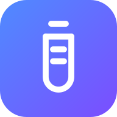
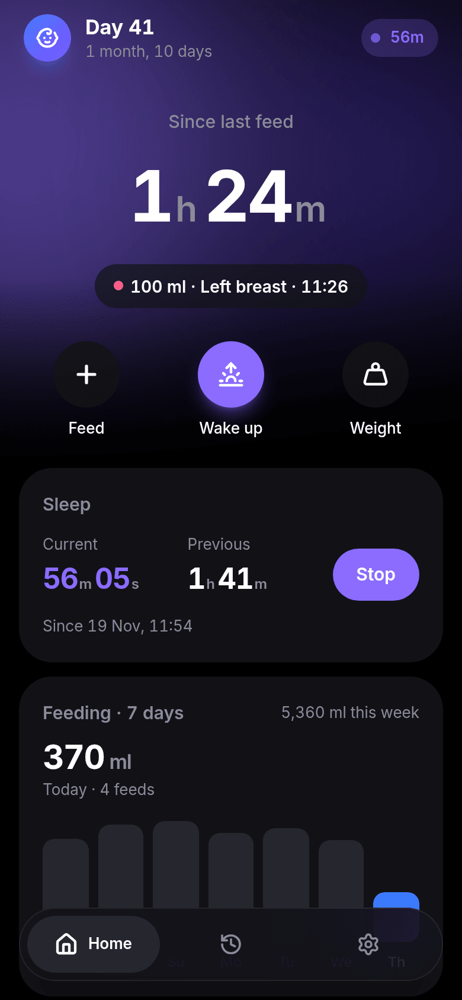
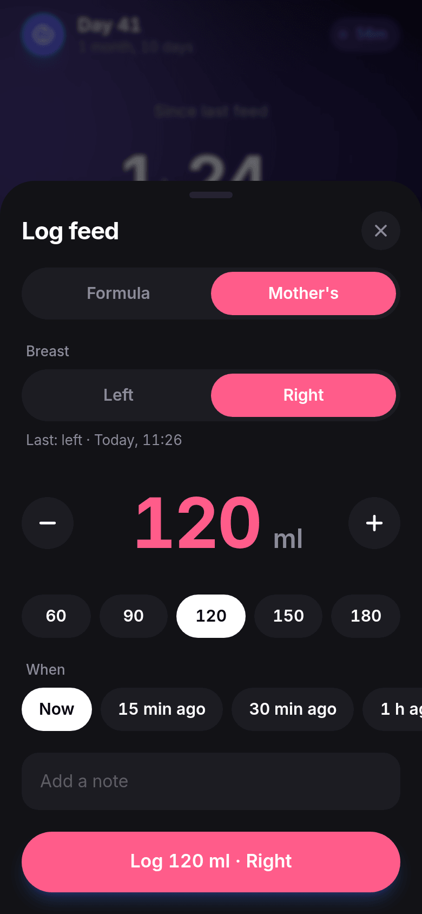
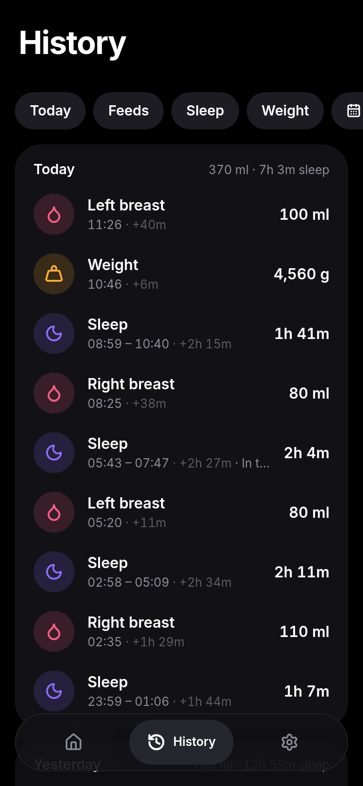
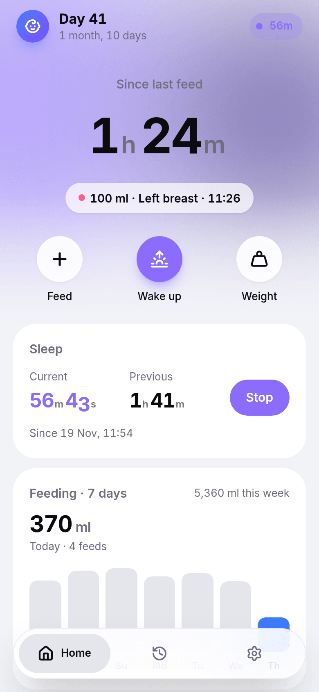

<div align="center">



# FeedApp

**A fast, self-hosted baby tracker for feeds, sleep and weight.**<br>
Installable on any phone, private by design, runs on a Raspberry Pi.

[](https://github.com/kvboe/FeedApp/actions/workflows/docker.yml)
[](LICENSE)


&nbsp;
&nbsp;
&nbsp;


</div>

> [!NOTE]
> **FeedApp 2.0 is in testing.** Thank you for trying it! If something looks wrong, feels slow or is confusing, please
> [open an issue](https://github.com/kvboe/FeedApp/issues/new/choose). See [Testing FeedApp](#testing-feedapp) for what to try.

## Contents

- [Features](#features)
- [Quick start](#quick-start)
- [Installation](#installation)
  - [1. Run the server](#1-run-the-server)
  - [2. Open it on your phone](#2-open-it-on-your-phone)
  - [3. Add it to your home screen](#3-add-it-to-your-home-screen)
  - [Optional: HTTPS and remote access](#optional-https-and-remote-access)
- [Using FeedApp](#using-feedapp)
- [Updating](#updating)
- [Backup and restore](#backup-and-restore)
- [Uninstalling](#uninstalling)
- [Security](#security)
- [Troubleshooting](#troubleshooting)
- [Testing FeedApp](#testing-feedapp)
- [For developers](#for-developers)
- [License](#license)

## Features

| | |
|---|---|
| 🍼 **Feeds** | Formula or mother's milk, in ml. For mother's milk, pick the **left or right breast**; the app shows which side and when was used last. Quick amount chips, ±10 ml steppers, and backdating ("15 min ago", "1 h ago" or any number of minutes). |
| 🌙 **Sleep** | One tap to start, one to wake up. A live timer, an optional note, and a "sleeping" badge on the dashboard. Safe with several phones: a stale screen can't stop a sleep it meant to start. |
| ⚖️ **Weight** | Log grams, see the change since the last weigh-in and a trend line. |
| 📊 **Dashboard** | A live "since last feed" counter, current and previous sleep, a 7-day feeding chart (tap a bar for that day), recent entries, and the baby's age ("Day 41 · 1 month, 10 days"). |
| 🗂️ **History** | Entries grouped by day like a banking app, with daily totals and the time between entries. Filter by Today, Feeds, Sleep, Weight or a date range. |
| ✏️ **Edit anything** | Tap an entry to change its type, side, amount or time, or delete it. |
| 👨‍👩‍👧 **Shared** | Both parents use the same server. Every phone refreshes every 30 seconds, and right away when you switch back to the app. |
| 📱 **Installable** | Add it to the home screen and it opens full-screen like a native app, with shortcuts for "Log feed" and "Sleep". Dark, light or automatic theme. |
| 🔒 **Private** | Runs on your own hardware. No account, no cloud, no tracking. Your data is one SQLite file. |

## Quick start

If you already have Docker, this is all you need:

```bash
docker run -d --name feedapp --restart unless-stopped \
  -p 8001:8000 -v feedapp_data:/data \
  ghcr.io/kvboe/feedapp:latest
```

Then open `http://<your-computer's-IP>:8001` on your phone. The full walkthrough is below.

## Installation

### What you need

- **A computer that stays on** in your home network: a Raspberry Pi 4 or 5 (64-bit Raspberry Pi OS), a home server, a NAS with Docker, or any Linux, macOS or Windows machine.
- **[Docker](https://docs.docker.com/get-docker/)** with Docker Compose. On a Raspberry Pi: `curl -fsSL https://get.docker.com | sh`, then log out and back in.
- **A phone** with Safari (iOS) or Chrome (Android), on the same Wi-Fi or connected through a VPN.

The image is about 190 MB and needs very little memory, so a Raspberry Pi handles it easily.

### 1. Run the server

**Option A: Docker Compose (recommended).** Easy to update and back up.

```bash
mkdir feedapp && cd feedapp
curl -fsSLo docker-compose.yml https://raw.githubusercontent.com/kvboe/FeedApp/v2.0.0/deploy/docker-compose.yml
docker compose up -d
```

<details>
<summary>Or create <code>docker-compose.yml</code> yourself</summary>

```yaml
services:
  feedapp:
    image: ghcr.io/kvboe/feedapp:latest
    container_name: feedapp
    ports:
      - "8001:8000" # change the left number to use another port
    volumes:
      - feedapp_data:/data
    restart: unless-stopped

volumes:
  feedapp_data:
```

</details>

**Option B: plain Docker.** Use the command from [Quick start](#quick-start).

**Option C: build from source.** Use this if you want to change the code.

```bash
git clone https://github.com/kvboe/FeedApp.git
cd FeedApp
docker compose up -d --build
```

After a few seconds, check that it is running:

```bash
docker ps --filter name=feedapp   # STATUS should say "(healthy)"
```

### 2. Open it on your phone

Find the server's IP address in your network:

| System | Command |
|---|---|
| Raspberry Pi / Linux | `hostname -I` (first address) |
| macOS | `ipconfig getifaddr en0` |
| Windows | `ipconfig` (look for "IPv4 Address") |

On your phone, open **`http://<that-IP>:8001`**, for example `http://192.168.1.50:8001`. You can also use the hostname, for example `http://raspberrypi.local:8001`.

### 3. Add it to your home screen

| iPhone / iPad (Safari) | Android (Chrome) |
|---|---|
| Tap **Share** (the square with an arrow), then **Add to Home Screen**. | Tap the **⋮** menu, then **Add to Home screen** or **Install app**. |

FeedApp then opens full-screen without browser bars. On Android, long-press the icon for the **Log feed** and **Sleep** shortcuts.

Do the same on every phone that should share the data.

### Optional: HTTPS and remote access

Everything works over plain `http://` in your home network. HTTPS adds two things:

- **Offline start:** browsers enable the service worker only over HTTPS (or on `localhost`), so the app shell then opens even without a connection.
- **Secure remote access:** you can log entries away from home.

The easiest way to get both is [Tailscale](https://tailscale.com): install it on the server and on your phones, then run this on the server:

```bash
sudo tailscale serve --bg 8001
```

FeedApp is then available at `https://<server-name>.<your-tailnet>.ts.net` on every device in your tailnet, with a valid certificate. Any other VPN (WireGuard, your router's VPN) or a reverse proxy with HTTPS (Caddy, Traefik, nginx) works too.

> [!WARNING]
> FeedApp has no login. **Never forward its port to the internet.** See [Security](#security).

## Using FeedApp

1. **Set the birth date.** Open **Settings** and enter the baby's birth date. The dashboard then shows the age, for example "Day 41".
2. **Log a feed.** Tap **Feed**, choose **Formula** or **Mother's**, pick a breast side for mother's milk, set the amount and tap **Log**. If you're logging after the fact, choose "15 min ago", "30 min ago", "1 h ago" or a custom time.
3. **Track sleep.** Tap **Sleep** when the baby falls asleep and **Wake up** when they wake. The timer keeps running on every phone, even if the app is closed.
4. **Weigh in.** Tap **Weight** and enter grams.
5. **Fix mistakes.** Tap any entry on the dashboard or in **History** to edit or delete it.

Times are stored in UTC and shown in each phone's own time zone, so the daily totals stay correct across daylight-saving changes and when travelling.

## Updating

Your data is kept in the `feedapp_data` volume, so updating never touches it.

```bash
# Docker Compose
docker compose pull && docker compose up -d

# Plain Docker
docker pull ghcr.io/kvboe/feedapp:latest
docker rm -f feedapp
docker run -d --name feedapp --restart unless-stopped -p 8001:8000 -v feedapp_data:/data ghcr.io/kvboe/feedapp:latest

# From source
git pull && docker compose up -d --build
```

Phones pick up the new version the next time the app is opened. If one doesn't, close the app completely and open it again.

**Image tags:**

| Tag | Contents |
|---|---|
| `latest` | the newest build of the default branch (recommended) |
| `sha-<commit>` | one exact build, if you want to pin a version |

## Backup and restore

All data is one SQLite file, `/data/feedapp.db`, inside the container. Run these commands in the folder with your `docker-compose.yml`. With plain Docker, replace `docker compose exec feedapp` and `docker compose cp feedapp:` with `docker exec feedapp` and `docker cp feedapp:`.

**Back up** (safe while the app is running):

```bash
docker compose exec feedapp python -c "import sqlite3; sqlite3.connect('/data/feedapp.db').backup(sqlite3.connect('/data/backup.db'))"
docker compose cp feedapp:/data/backup.db ./feedapp-backup-$(date +%F).db
```

**Restore:**

```bash
docker compose stop
docker compose cp ./feedapp-backup-2026-01-31.db feedapp:/data/feedapp.db
docker compose start
```

To back up automatically every night, add the two backup lines to a script and run it from `cron`.

## Uninstalling

```bash
docker compose down        # stop and remove the container, keep the data
docker compose down -v     # also DELETE all data (back up first!)
```

Then remove the icon from your phone's home screen.

## Security

FeedApp is built for a **trusted home network**. It has **no user accounts or passwords**: anyone who can reach the port can read and change the data.

- ✅ Use it on your home Wi-Fi, or remotely through a VPN such as Tailscale or WireGuard.
- ❌ Don't forward the port on your router or expose it to the internet. If you really must, put it behind a reverse proxy that requires a login.
- Write requests must be sent as JSON, so a malicious website opened on a phone in your network can't add entries behind your back.

To report a vulnerability, see [SECURITY.md](SECURITY.md).

## Troubleshooting

<details>
<summary><b>The phone can't open the page</b></summary>

- Make sure the phone is on the **same Wi-Fi** as the server, or connected to your VPN. Guest Wi-Fi networks often block access to other devices.
- Check that you used `http://` (not `https://`) and the right port, for example `http://192.168.1.50:8001`.
- On the server, `curl http://localhost:8001/api/health` should print `{"status":"ok"}`.
- A firewall on the server may block the port. On Ubuntu, for example: `sudo ufw allow 8001/tcp`.

</details>

<details>
<summary><b>The container keeps restarting or is "unhealthy"</b></summary>

Look at the logs: `docker compose logs --tail 50 feedapp`. If the port is already in use, change the left number in `ports`, for example `"8080:8000"`.

</details>

<details>
<summary><b>"Bind for 0.0.0.0:8001 failed: port is already allocated"</b></summary>

Another program uses port 8001. Pick another port: `"8080:8000"` in `docker-compose.yml`, or `-p 8080:8000` with `docker run`.

</details>

<details>
<summary><b>Times or daily totals look wrong</b></summary>

FeedApp uses each phone's own time zone. Check the date, time and time zone in the phone's settings (set them to automatic). The server's time zone doesn't matter.

</details>

<details>
<summary><b>A phone still shows the old version after an update</b></summary>

Close the app completely (swipe it away) and open it again. In a browser tab, reload the page.

</details>

<details>
<summary><b>"Frontend not built" (when running from source without Docker)</b></summary>

Build the frontend first: see [For developers](#for-developers).

</details>

## Testing FeedApp

Thank you for testing! The most useful things to try are:

- **Daily use:** log feeds, sleep and weight like you normally would for a few days.
- **Two phones:** use the app on two phones at once. Do changes show up on the other phone? Try starting a sleep on one phone while the other is open.
- **Editing:** change the times of older entries, switch a feed between formula and mother's milk, delete entries.
- **Installed app:** add it to the home screen, then use the shortcuts, close and reopen it, and switch between apps.
- **Edge cases:** midnight, very short or very long sleeps, backdated feeds, dark and light mode, small and large phones.

**Reporting a problem:** open an [issue](https://github.com/kvboe/FeedApp/issues/new/choose) and include:

- your phone and browser, for example "iPhone 15, iOS 18, installed app" or "Pixel 8, Chrome";
- the steps that lead to the problem, and what you expected to happen;
- a screenshot or screen recording, if you can.

Please leave out real names and personal data.

## For developers

<details>
<summary><b>Tech stack</b></summary>

| Layer | Tech |
|---|---|
| Frontend | React 19, TypeScript, Vite, Tailwind CSS 4, Motion, TanStack Query, NumberFlow, Lucide icons, Inter |
| Backend | Python 3.12, FastAPI (JSON API under `/api`), Pydantic, SQLite |
| Deploy | Multi-stage Docker image: Node builds the SPA, Python serves the API and the static files. GitHub Actions publishes amd64 and arm64 images to GHCR. |

</details>

<details>
<summary><b>Local development</b></summary>

```bash
# Backend (http://127.0.0.1:8000)
python3 -m venv .venv && source .venv/bin/activate
pip install -r requirements.txt
uvicorn app.main:app --reload

# Frontend with hot reload (http://localhost:5173, proxies /api to :8000)
cd frontend
npm install
npm run dev
```

| Script | What it does |
|---|---|
| `npm run typecheck` | TypeScript check |
| `npm run build` | Production build to `frontend/dist` |
| `npm run preview` | Serve the production build |

Without Node installed locally, build with Docker:

```bash
docker run --rm -u $(id -u):$(id -g) -v $PWD/frontend:/app -w /app node:22-alpine sh -c "npm ci && npm run build"
```

FastAPI serves `frontend/dist` once it is built. Without a build, non-API routes return HTTP 503 "Frontend not built".

| Variable | Default | Purpose |
|---|---|---|
| `DB_PATH` | `feedapp.db` (Docker: `/data/feedapp.db`) | SQLite database file; the folder is created if missing |

</details>

<details>
<summary><b>API</b></summary>

All timestamps are ISO 8601. The API returns UTC (`…+00:00`) and accepts any offset. `POST`, `PUT` and `PATCH` requests must use `Content-Type: application/json`. Interactive docs are at `/docs`.

| Method | Path | Purpose |
|---|---|---|
| GET | `/api/health` | Liveness check: `{"status": "ok"}` |
| GET | `/api/summary?tz=&tz_offset=` | Last feed, last breast-side feed, last sleep, last weight, sleep state, 7-day totals and birth date. Week totals follow DST when given an IANA `tz`. |
| GET | `/api/entries?type=&start=&end=&limit=&before_created_at=&before_id=` | History, newest first. Keyset-paged: pass the last item of the previous page. |
| GET | `/api/entries/{id}` | A single entry |
| POST | `/api/feeds` | `{subtype: "formula" \| "breast_milk", side?: "left" \| "right", amount_ml, notes?, created_at?}`. `side` is stored only for `breast_milk`. |
| POST | `/api/weights` | `{weight_g, notes?, created_at?}` |
| POST | `/api/sleep` | `{action: "start" \| "stop", notes?}`. Returns 409 if the state already changed, for example on another phone. |
| PATCH | `/api/entries/{id}` | Partial edit; only the fields sent are changed. Switching a feed to formula clears its side. |
| DELETE | `/api/entries/{id}` | Delete an entry |
| GET / PUT | `/api/settings` | `{birthdate}` |

</details>

<details>
<summary><b>Project structure</b></summary>

```
app/                 FastAPI backend
  main.py            routes, CSRF guard, SPA hosting
  crud.py            SQL queries
  database.py        connection handling, schema and startup migrations
  schemas.py         Pydantic models
frontend/            React SPA
  src/screens/       Home, History, Settings
  src/sheets/        Feed, Sleep, Weight, Edit bottom sheets
  src/components/    UI kit (BottomSheet, Segmented, EntryRow, WeekChart, …)
  src/lib/           API client, queries, time helpers, types
  public/            manifest, service worker, icons
deploy/              docker-compose.yml for the prebuilt image
docs/screenshots/    images used in this README
Dockerfile           multi-stage, multi-arch build
docker-compose.yml   build-from-source service on port 8001
```

</details>

<details>
<summary><b>Upgrading from FeedApp 1.x</b></summary>

FeedApp 2 reads the 1.x database as-is. On startup it adds a nullable `side` column, rewrites any non-canonical timestamps to UTC and creates two indexes. These changes are additive, but 1.x was never tested against a migrated database, so back up first (see [Backup and restore](#backup-and-restore)). The original 1.x app (FastAPI + HTMX + Jinja) lives on the [`legacy`](https://github.com/kvboe/FeedApp/tree/legacy) branch.

</details>

See [CHANGELOG.md](CHANGELOG.md) for what changed in each version.

## License

[MIT](LICENSE). FeedApp is a hobby project and not a medical device. Ask your pediatrician about feeding, sleep or weight concerns.
